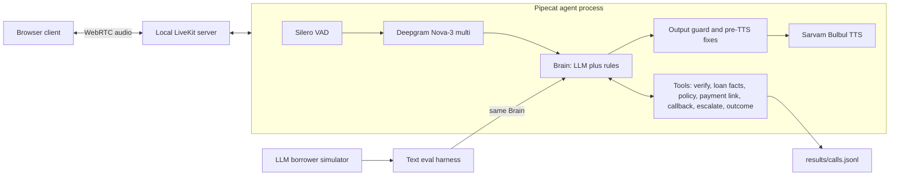

# Lumen Finance EMI Reminder Voice Agent

An outbound voice agent that calls a borrower about an upcoming or overdue EMI, in English, Hindi or Hinglish, and tries to sound like a capable, polite human caller. It verifies the borrower, states the EMI, finds out what they intend to do (pay, promise a date, dispute, hardship, callback, stop) and writes one structured outcome record per call.

Lumen Finance is fictional and all borrower data is mock data. Everything runs on a laptop: [Pipecat](https://github.com/pipecat-ai/pipecat) for the voice pipeline, a local [LiveKit](https://livekit.io) server for audio, and a small browser page as the phone.

## Deliverables at a glance

| Brief | Where |
|---|---|
| 1. Code, README: how to run the agent and the evals, how a call is structured, key design decisions | This README: [Run it locally](#run-it-locally), [Evals](#evals-how-they-work), [How a call goes](#how-a-call-goes), [Key design decisions](#key-design-decisions); code in [`src/emi_agent/`](src/emi_agent/) |
| 2. Demo recording, 2 or 3 calls, one difficult borrower | [`DemoRecordings/`](DemoRecordings/): three live calls, audio only (the picture is blank), 5 min in total. See [Demo recordings](#demo-recordings) |
| 3. Eval suite and results: scenarios, runner, report | Scenarios [`evals/scenarios/`](evals/scenarios/) (31), runner [`evals/run.py`](evals/run.py), scorer [`evals/score.py`](evals/score.py), report [`docs/eval-report.md`](docs/eval-report.md) |
| 4. Mock data and mock tools (payment link, outcome logging) | [`data/borrowers.json`](data/borrowers.json), [`data/policy.yaml`](data/policy.yaml), [`src/emi_agent/tools.py`](src/emi_agent/tools.py); see [Mock data and tools](#mock-data-and-tools) |

Every defect found and fixed, with evidence: [`docs/issues-and-fixes.md`](docs/issues-and-fixes.md).

## Demo recordings

Three live voice calls through the full stack (browser phone, local LiveKit, Pipecat, Deepgram, Sarvam), recorded on 4 Nov 2026. The owner plays each borrower. The files are MP4 with sound only. Each call's report page (outcome record, transcript, latency per turn, tool calls, guard events) is linked in the table below; GitHub shows these files as HTML source, so open them in a browser after cloning.

| File | Call | What it shows | Call page |
|---|---|---|---|
| [`21-37-48_Normal.mp4`](DemoRecordings/) | B001, English, EMI due tomorrow | AI disclosure, verification by the last four digits, "give me a moment" handled, link sent on WhatsApp, promise date asked once and recorded for 5 Nov | [`results/calls/20261104-213709-B001.html`](results/calls/20261104-213709-B001.html) |
| [`22-11-30_hardship.mp4`](DemoRecordings/) | B007, overdue 14 days, **difficult: lost her job** | Wrong last four, recovery through the date of birth; English and Hindi mixed; the practical hardship reply (one-time charge that will not grow, part payment, team call back, one choice); no waiver or date promised; escalated as hardship | [`results/calls/20261104-221126-B007.html`](results/calls/20261104-221126-B007.html) |
| [`22-21-26_dispute.mp4`](DemoRecordings/) | B002, Hindi, overdue 6 days, says she already paid | Does not argue; says the internal team will check the payment; asks how she paid; outcome already_paid, escalated for a payment check | [`results/calls/20261104-222132-B002.html`](results/calls/20261104-222132-B002.html) |

The plan for the recordings, and an optional fourth call where no word list matches and the LLM intent check decides, is [`docs/demo-script.md`](docs/demo-script.md).

## Core idea: code owns the rules, the LLM owns the language

The model writes the words, handles empathy and follows the borrower's language. Anything that must never go wrong is decided in code, with the prompt as a second line of defence:

| Rule | Where it is enforced |
|---|---|
| No loan detail before identity is verified (G-01, G-02) | The model sees no loan data before verification; loan tools refuse; a per-sentence output guard; a disclosure log the evals check |
| Identity check and attempt counting | Code reads the last four digits or the date of birth from the transcript and checks it; at most 3 attempts; no hints |
| No made-up verification result | Code replaces "that doesn't match" or "last chance" when no check has failed in that turn |
| No threats, shaming, waivers or discounts (G-03, G-04) | Output guard in English and Hindi (Devanagari and romanised) replaces the sentence with a safe line; reading back the borrower's own request ("you'd like a waiver") is allowed, any commitment is not |
| Never an invented amount or fee (G-08) | Every rupee amount spoken must be the borrower's EMI, a charge already applied, the repayment policy, or a figure the borrower said; "a late charge has been added" on a loan with none is replaced by the true policy line |
| Escalation for dispute, hardship, explicit request (G-05) | Tool flag set by code. Hardship, wrong amount, "not my loan" and waiver demands then follow a **code-owned flow**, one step per turn; for hardship: one plain line, the true facts (the late charge is one-time and will not grow, any part payment goes towards the EMI, the team can check options), one choice; then read back and hand off to "our internal team, who will check and arrange a call back"; close. A step moves on only when the borrower heard it (a reply cut while playing is given again). Code checks that a hardship or dispute is real: word lists first, and when none match, an LLM intent check that sees only the borrower's lines with digits hidden |
| Stop means stop (G-06) | Code detects stop requests (English, Hindi, mixed script) and closes in one turn: an apology, and only if verified one gentle line that it was just a reminder so no late fee is added |
| Answers to questions about paying | A generic repayment policy (`data/policy.yaml`): late fee, grace period, part payment, how to pay, credit score only if asked; short version in the prompt, detail through a tool |
| Amounts and dates said aloud correctly | Code formats them ("twelve thousand five hundred rupees", "the twenty-eighth of October") and resolves "next Friday" or "parso" against a fixed today |
| A valid outcome record | Pydantic schema; code fills in the outcome if the model forgets; "already paid" needs the borrower to have said so; "I'll pay by the due date" is recorded as a promise for the due date |
| No hidden reasoning spoken | Code drops any `<think>` text the model leaks into its reply, before speech and from history |

## How a call goes

1. Greeting: says once that it is an AI assistant from Lumen Finance and confirms it is speaking to the borrower. Wrong number or a family member: polite close, nothing disclosed.
2. Verification, "for account verification": asks for the **last four digits of the registered mobile number**; if they do not match, the **date of birth**. A date of birth offered first is accepted too. Three attempts at most.
3. Reminder: the EMI amount and due date. Code tells the model whether it is not yet due (no charge, offer the link before the due date) or overdue (the late charge once, can it be cleared today).
4. Intent and questions: payment link (mock SMS or WhatsApp), promise-to-pay date, callback time, "already paid" (our internal team checks it), answers about the late fee or part payment from the policy, hardship or dispute (the code-owned flow), stop.
5. Close: thanks the borrower ("आपका दिन शुभ हो") and writes the outcome to `results/calls.jsonl`.

The agent follows the borrower's language at runtime (English, Hindi, Hinglish; the start language comes from the borrower's record). In Hindi it uses everyday words, and its questions to the borrower fit a man or a woman.

Example outcome record from a live call:

```json
{"borrower_id":"B002","verified":true,"outcome":"already_paid","promise_to_pay_date":null,
 "payment_link_sent":false,"escalate_to_human":true,
 "notes":"Borrower says she already paid via UPI but did not specify the date.",
 "language_used":"hi+en","callback_time":null}
```

## Key design decisions

The full log, with the alternatives and reasons, is [`docs/design.md`](docs/design.md) (D-01 to D-48). These are the ones that shape the agent most:

1. **Code owns the rules; the LLM owns the language (D-01).** Verification, what the model may see, tool permissions, amounts and dates, stop, escalation and the outcome record are decided in code. The prompt is the second line of defence. The model cannot leak a loan detail it has never been shown.
2. **The text Brain first, voice around it (D-03).** The voice bot and the eval harness call the same `Brain`, so the evals test what is shipped. Iterating on guardrails costs text tokens, not phone calls.
3. **Code-owned flows for the hard moments (D-40, D-43, D-44).** Hardship, wrong amount, "not my loan" and waiver demands follow fixed steps, one per turn: acknowledge and ask one question, read back and hand off, close. Stop closes in one turn. Prompt patches alone kept failing live (C19), which is why these moved into code.
4. **Numbers and dates are spoken by code (D-10, D-19).** The model passes on the borrower's own words ("parso", "month end"). Code resolves the date and formats the rupees, so they are read aloud correctly in English or Hindi.
5. **Append-only context (D-18).** The system prompt and the tool list stay fixed for the whole call; changes mid-call arrive as notes. This keeps the provider's prompt cache warm and the behaviour predictable.
6. **No dead air (D-36, D-46).** A short bridge line plays while a tool runs. A filler plays if the model is slow past 1.2 s. After 2.5 s the call falls back to a second LLM.
7. **Providers by config, chosen by measurement (D-04 to D-09, D-31).** STT, TTS and the LLM come from a config profile. The choices come from bake-offs on a Hinglish test set (`bakeoff/`, `results/`). Smart Turn v3 was measured and not adopted.
8. **Rules with an LLM fallback for understanding (D-47).** Word lists cannot cover every way a borrower names money trouble ("ghar mein haath tang hai"). When the agent escalates and no list matches, a short LLM check reads only the borrower's last lines, digits hidden, and returns an intent label (code decides from it), a one-line reason (for the outcome notes) and a warm opening line (guidance for the agent, which stays the one voice behind the guards). A failed or slow check lets the escalation through.
9. **Practical sympathy, the banking way (D-48).** Hardship gets one plain line and then facts that help, never pressure: the charge is one-time and will not keep increasing, any part payment goes towards the EMI, the team can check options. No "don't worry", no promises.
10. **Evals: rules first, a calibrated judge only for tone.** See [Evals](#evals-how-they-work).

## Architecture



The Brain (`src/emi_agent/brain.py`) is plain Python with no audio code. The voice pipeline and the text eval harness call the same Brain, so what is evaluated is what is shipped.

### Current stack

| Part | Choice | Why |
|---|---|---|
| STT | Deepgram Nova-3, `language=multi`, EU host, endpointing 100 ms | Handles Hindi-English code-switching in one stream; EU host measured ~150 ms closer than the US default from here |
| LLM | Sarvam `sarvam-105b-conversations`; Groq `gpt-oss` as fallback | Fastest first text measured for Hinglish replies; billed in rupees |
| TTS | Sarvam Bulbul v4-flash (Hindi in Devanagari, English terms in Latin); pace 0.9 once hardship is heard | Reads Hinglish and spoken numbers correctly in clip checks; pace measured to lengthen speech ~10-15% (3 renders); the voice is a placeholder until blind listening scores are in; Cartesia Sonic is a config option |
| Turn detection | Silero VAD (0.5 s stop) plus an "unfinished sentence" wait (0.7 s, 1.2 s once hardship is heard) | Smart Turn v3 was tried and is kept as an option, not the default |
| Transport | Pipecat LiveKit transport, local `livekit-server --dev` | Local only, no cloud deployment |

Providers are chosen by config profile (`configs/`), not code. Every decision and its alternatives are in [`docs/design.md`](docs/design.md).

## Mock data and tools

All data is fictional. Nothing leaves the laptop: no message is sent and no ticket is opened.

| File | Holds |
|---|---|
| [`data/borrowers.json`](data/borrowers.json) | 8 borrowers (B001 to B008): name, date of birth, last four mobile digits, loan type, EMI, due date, days overdue, preferred language, late fee. The mix is upcoming and overdue, English, Hindi and Hinglish |
| [`data/policy.yaml`](data/policy.yaml) | A generic repayment policy: late fee, grace period, part payment, how to pay, credit score |
| [`src/emi_agent/tools.py`](src/emi_agent/tools.py) | Mock tools the model can call. `verify_identity` is checked by code against the record and what the borrower said. `get_loan_details` only works after verification. `get_policy`. `send_payment_link` (WhatsApp or SMS) returns a fake link and can be made to fail for evals. `schedule_callback`. `escalate_to_human` sets the flag. `record_outcome` checks the record against a Pydantic schema |
| `results/calls.jsonl` | One outcome record per call (outcome logging), plus a page per live call in `results/calls/` |

## Run it locally

Requirements: Linux or macOS, Python 3.10+, the [`livekit-server`](https://docs.livekit.io/home/self-hosting/local/) binary, a microphone, and API keys for Deepgram and Sarvam (Groq optional for the fallback, Cartesia optional).

```bash
git clone https://github.com/SinghSeema/LumenFinance.git && cd LumenFinance
./run.sh setup          # installs, creates .env (add DEEPGRAM_API_KEY and SARVAM_API_KEY), checks keys and livekit-server, runs the tests
./run.sh call B002      # starts LiveKit, the browser client and the agent; open http://localhost:8080 and press call
```

Ctrl-C ends the call and stops all three processes. Logs go to `logs/` (LiveKit, client, and one `bot-<borrower>-<time>.log` per call; `bot-<borrower>.log` links to the latest). `./run.sh` with no argument lists the other commands (`test`, `evals`, `judge`, `report`).

The same steps by hand, in three terminals:

```bash
livekit-server --dev                                              # 1: local LiveKit (keys devkey / secret)
PYTHONPATH=src python3 -m emi_agent.bot --profile hindi_bulbul --borrower B002   # 2: the agent joins the room
python3 scripts/serve_client.py                                   # 3: open http://localhost:8080
```

`--borrower` picks a mock borrower from [`data/borrowers.json`](data/borrowers.json); `--today 2026-11-04` fixes the date; `--set section.key=value` overrides any config value. A missing key fails at start-up with the variable's name.

After each call the agent prints the outcome record, token usage and a latency table (VAD stop to transcript, transcript to first sentence, first sentence to audio). It also writes one page per call, `results/calls/<time>-<borrower>.html`, with the outcome record, transcript, latency per turn (median and p90), tool calls and any sentence the code guards changed; the log prints its `file://` link.

**Demo.** The recorded calls are in [`DemoRecordings/`](DemoRecordings/) (see [Demo recordings](#demo-recordings)); [`docs/demo-script.md`](docs/demo-script.md) has the lines used and more calls to try.

**Borrower on a video call.** To let someone in a meeting (Meet, Zoom) play the borrower, `./scripts/meeting_audio.sh up` (Linux, PulseAudio) routes the meeting's audio into the call page's microphone and the agent's voice back into the meeting, all on this laptop. In the meeting app choose Speaker "Lumen_from_meeting" and Microphone "Lumen_meeting_mic", wear headphones, and run `./scripts/meeting_audio.sh down` afterwards. `mic off` / `mic on` mutes you towards the meeting; the agent never hears you.

## Evals: how they work

The brief asks how we know the agent is good, and where it is not. The answer has four parts.

**1. Scenarios.** 31 YAML files in [`evals/scenarios/`](evals/scenarios/), one per borrower type the brief lists plus tricky cases (wrong verification three times, waiver demand, "stop calling", vague dates, mumbled digits, a payment-link tool that fails, "already paid" while overdue, and borrowers who ask about the late fee, grace period, auto-debit, CIBIL or paying cash). Each states the borrower **persona**, a **hidden goal** the simulated borrower follows, and the **expected outcome record**. 16 are dev scenarios used while building (S31, a hardship in words no list knows, added after the demo calls), and 5 are the original hold-out. 10 are stress scenarios (S21 to S30: part payment, the borrower has died, change the EMI date, driving, foreclosure amount, an unsupported language, a child answers, wants a cash agent, suspects fraud, abusive). They were written after the last fixes and never run or tuned against before the v17 hold-out run, so they are the unseen hold-out. Honest note: original hold-out S11 was used while tuning (E12).

**2. Automated runs with a simulated borrower.** `evals/run.py` runs the real agent (the same Brain, tools, guards and prompt as the voice bot; only audio is skipped) against an LLM playing the borrower (`evals/simulator.py`, `glm5.3-flash`, a different model family from the agent's `sarvam-105b`). The simulator sees the persona, the hidden goal and today's date, never the expected outcome. Every scenario runs 5 times because conversations vary. Each conversation is saved in full: turns, tool calls and results, the outcome record, guard hits and a log of every loan fact the model was shown.

**3. Scoring: rules first, a judge only where no rule works.**

| How | What it scores | Trust |
|---|---|---|
| Rules (`evals/score.py`) | Outcome record vs expected (M1); loan detail before verification, from the disclosure log plus a scan of every unverified turn (M2, zero tolerance); promise date (M3); escalation precision and recall (M4); reply language (M6); process checks: says it is an AI when asked, no invented payment link after a tool failure, asks one clear question on a vague date (M11); turns per call (M8) | High |
| Code guard, counted per run | Sentences replaced before speech for threats, waiver promises or early disclosure (M5) | High |
| LLM judge (`evals/judge.py`) | Tone (M7): politeness, empathy, firmness without pressure, clarity of the reminder, natural phrasing, each 1 to 5, plus guardrail flags. `glm5.3-flash`, temperature 0, rubric v3 (the agent's real rules stated, so correct refusals are not marked down). A flag must quote the agent's exact words; a quote not found in the transcript is dropped | **Medium**: calibrated against the owner's hand labels on 9 v17 conversations (`./run.sh calibrate`): within one point 78% of the time (Groq gpt-oss-120b 73%). It is about one point too generous on clarity and naturalness and agrees on empathy. Its scores are shown with that offset and never decide a pass |
| Hand review (`evals/failure_review.yaml`) | Every failed conversation is read in full and marked as an agent defect, a code bug, or a test-side error (simulator off script, scorer wrong) | The final word on what a failure means |
| Live-call timestamps (`results/latency/`) | Latency per turn (M9): VAD stop, final transcript, first sentence, first audio | High for what was measured |

**4. Report and dashboard.** [`docs/eval-report.md`](docs/eval-report.md) is the write-up the brief asks for: results, real failures, what changed, what to fix next. `results/dashboard.html` shows the same evidence visually: pass rate per borrower type before and after fixes, metrics with trust, a latency histogram against the targets, the reviewed failures, and every conversation readable with its tool calls and outcome record. Open it in a browser; it needs no network.

```bash
./run.sh test                                    # 1068 unit and replay tests, no network
./run.sh evals --scenarios all --runs 5          # all 31 scenarios x5 (paid; prints a cost estimate and asks first)
./run.sh evals --scenarios S13,S14a --runs 5     # chosen scenarios
./run.sh evals --scenarios all --runs 5 --resume results/<run>   # finish a run that was cut short
./run.sh judge results/<run>                     # tone judge on a finished run (paid; asks first)
./run.sh label                                   # hand-labelling page for judge calibration
./run.sh calibrate                               # judges vs the owner's labels
./run.sh report results/<run>                    # markdown tables for the report
./run.sh dashboard results/<baseline> results/<after-fix>   # writes results/dashboard.html
```

Bake-off scripts for provider choices are in [`bakeoff/`](bakeoff/), for example `python3 -m bakeoff.stt_keyterms run` (Deepgram keyterm prompting on Hindi numbers and dates).

## Results so far

Measured figures only. Full write-up: [`docs/eval-report.md`](docs/eval-report.md); visual version with every conversation: `results/dashboard.html`.

| What | Result | Source |
|---|---|---|
| **Unseen stress scenarios S21 to S30, prompt v17, ×3** | **24/30 pass**; 0 leaks before verification. 4 real agent defects found (a callback promised in words but not recorded, a conditional "stop" taken as a stop, a child thanked by the borrower's name, a silent failed link retry) | `results/20261104-204947-v17-holdout-stress/` |
| Fixes from the owner's demo calls (C60 to C72): practical hardship, LLM intent check, a cut flow step given again | Hardship S03 ×2: 2/2 before and after; S31 (no word list matches) ×2: the intent check fired 2/2, labelled hardship, 476 to 870 ms; S08 ×2 no false escalation. Intent check model chosen by measurement: sarvam-105b-conversations 9/9 labels, median 393 ms, against glm5.3-flash 9/9, median 1072 ms (it timed out in a live call) | `results/20261104-222941-v17-intent-105b/`, `results/LOG.md` |
| Original hold-out, v17, ×3 | 14/15 (no longer clean: fixed against since v10, S11 used in tuning) | same run |
| After fixing the 4 defects (re-run S14b, S24, S27, S30 ×3) | 10/12; both failures are the simulator saying "stop" in its first turn, against its script | `results/20261104-210209-v17-holdout-fix/` |
| Dev scenarios, v17, ×2 | 26/29 + 1 provider timeout; escalation precision and recall 1.0. Open: S10 verification loop (C34) | `results/20261104-181142-v17-dev3/` |
| Leaks before verification | 0 in the 241 conversations of the runs listed here (v10 baseline and fixes, v17 dev, unseen and re-run). In the v17 unseen run, all 6 sentences the guard replaced for early disclosure were refusals, not leaks: the guard is too strict (C59, open) | runs above |
| Tone (LLM judge, calibrated) | Unseen run: politeness 4.76, empathy **3.00**, firmness 4.96, clarity 4.93, naturalness 3.87. Clarity and naturalness read about one point lower (calibration on 9 owner labels, 78% within one point). Empathy is the weakest area | `judge.json` in each run; `results/judge_calibration/` |
| Live call latency, current stack (18 calls, 96 turns) | Gap median 1139 ms (target 1.2 s met), p90 2527 ms (target 1.8 s missed), plus the 0.5 s VAD stop. The slow tail is tool turns and the first model request of a call | `results/latency/` |
| v10 baseline (history) | 76/85; dev 59/60 vs hold-out 17/25, the gap that showed tuning to the dev set; fixed to 28/30 over two rounds | `results/20261104-133125-v10-all5/` and fix runs |
| Deepgram keyterms (75 synthetic clips) | Date of birth read correctly 15/36 without, 26/36 with; last four digits 9/18 without, 15/18 with; no false numbers | `results/stt_keyterms/20261104-130330.txt` |

**Not yet done:** the latency p90 target; Sarvam LLM timeouts in live calls (about one per call on 4 Nov evening, covered by a filler and the Groq fallback, but the caller can wait 5 to 6 s, C69); empathy; the over-strict disclosure guard (C59); the S10 verification loop (C34); a callback offered without asking when after a failed link (C58); a fresh hold-out now that the stress set has been fixed against; voice-level evals (all scenario runs are text-level); the keyterm gain is from synthetic voices.

Every defect found so far, with evidence, root cause, fix and how it was checked, is in [`docs/issues-and-fixes.md`](docs/issues-and-fixes.md); the day-by-day measurement log is [`results/LOG.md`](results/LOG.md).

## Known limitations

- Deepgram's multilingual model sometimes mishears Hindi number words ("बाईस" as "buys") and on short answers can write Hindi or English in Telugu, Kannada or Bengali script. Keyterm prompting reduces this on synthetic clips; it stays off by default until it is checked on real recordings.
- The LLM sometimes ignores instructions (for example it once said "doesn't match" with no check run). Each case found is now caught in code, but new ones can appear; this is why rules live in code.
- Payment links, callbacks and escalations are mock tools; nothing is sent.
- One browser "phone" over local LiveKit; no telephony (SIP) in this build.

## Repository layout

```
src/emi_agent/   agent code: bot (Pipecat pipeline), brain, tools, guard, heard (number and date reading),
                 speech_format, dates, language, outcome, providers, keyterms, special (hardship and
                 dispute flow), policy, prompts/ (versioned v1 to v17)
configs/         defaults.yaml and provider profiles
data/            mock borrowers and the generic repayment policy
evals/           runner, LLM borrower simulator, rule-based scorer, scenarios
bakeoff/         provider and tuning experiments (STT latency and keyterms, TTS checks, LLM speed)
scripts/         browser client and its server, issues page renderer
tests/           unit and replay tests
docs/            requirements, HLD, LLD, design decisions, evals, issues and fixes, tuning playbook
results/         eval runs, latency logs, bake-off reports, LOG.md
```

## Documentation

| File | Holds |
|---|---|
| [`docs/requirements.md`](docs/requirements.md) | Functional and quality requirements, guardrail IDs (G-01 to G-11) |
| [`docs/HLD.md`](docs/HLD.md) | Architecture, the hybrid split, where each guardrail is enforced |
| [`docs/LLD.md`](docs/LLD.md) | State machine, tools, gating, formatter, dates, schema, config |
| [`docs/design.md`](docs/design.md) | Decision log (D-01 to D-48) with alternatives and reasons |
| [`docs/evals.md`](docs/evals.md) | Scenarios, metrics, judge calibration plan |
| [`docs/issues-and-fixes.md`](docs/issues-and-fixes.md) | Every defect found and how it was fixed and checked |
| [`docs/eval-report.md`](docs/eval-report.md) | Eval results, real failures, what changed, what next |
| [`docs/demo-script.md`](docs/demo-script.md) | The three demo calls |
| [`docs/tuning-playbook.md`](docs/tuning-playbook.md) | Latency and voice tuning experiments |

Built with AI assistance (Claude Code); [`CLAUDE.md`](CLAUDE.md) holds the working rules it followed.
