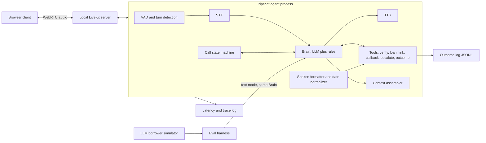
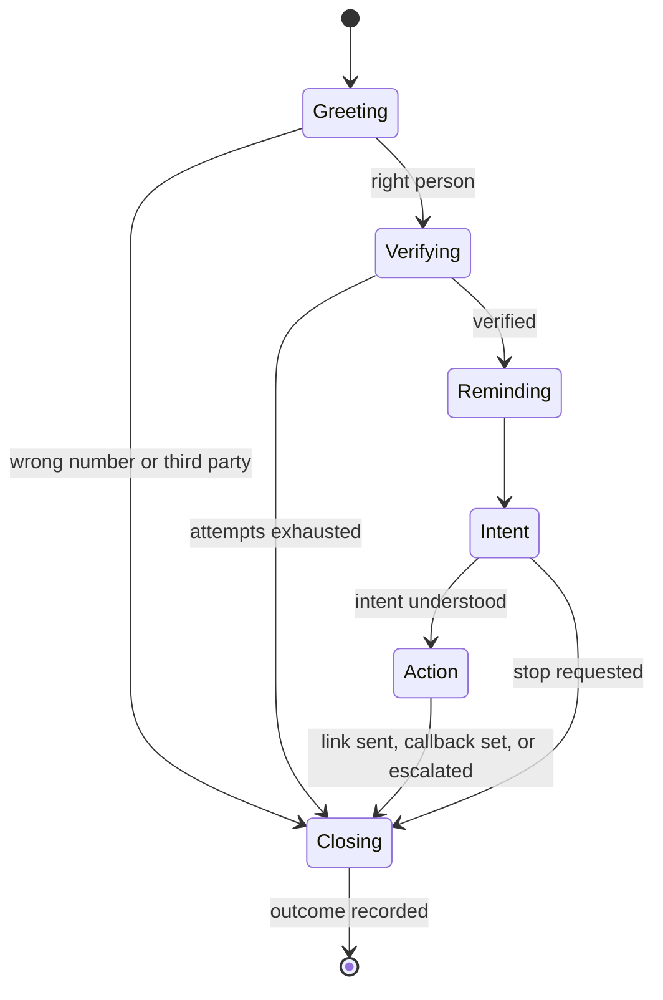

# High-Level Design

The system is a voice agent with one rule: code owns the rules, the LLM owns the language. This file shows the components, the hybrid split, the data flow and where each guardrail is enforced. Contracts are in `LLD.md`.

## 1. Components

Pipecat runs the audio pipeline (VAD, STT, Brain processor, TTS, interruption handling) and LiveKit carries the audio between the browser and the agent. The Brain is a plain Python module with no audio or framework code in it, wrapped by one thin Pipecat processor. The voice path and the text-mode eval harness both call the same Brain, so what is evaluated is what is shipped.

## 2. Hybrid split: rules in code, language in the LLM

| Concern | Owner | Why |
| --- | --- | --- |
| What the model may see (context assembly) | Code | A model cannot leak what it never saw |
| Which tools may run at each stage | Code | Blocks disclosure paths before verification (all tools are declared; code refuses gated ones, D-18) |
| Identity check, attempt counting | Code | Deterministic, no hints |
| Amounts and dates in spoken form | Code | Models misread numbers and format them like forms |
| Relative-date resolution | Code | "Next Friday" and "parso" need a fixed today |
| Timers: silence, max call length, filler delay | Code | Predictable timing |
| Outcome validation and escalation flags | Code | The record must be valid and consistent |
| Phrasing, tone, empathy | LLM | Where naturalness comes from |
| Understanding intent and the borrower's language | LLM | Open-ended input |
| Choosing which tool to call and with what arguments | LLM, checked by code | Flexible, but validated |
| Off-topic redirection, pushback handling | LLM | Needs judgment |

## 3. Defence in depth for disclosure (G-01, G-02, G-10)

1. **Context:** before verification the model sees only the borrower's first name, an ID and the rules. There is no loan data to leak.
2. **Tool gating:** before verification only `verify_identity`, `schedule_callback`, `escalate_to_human` and `record_outcome` are callable. `get_loan_details` and `send_payment_link` refuse.
3. **Output guard (light):** each sentence is scanned before TTS for amounts, dates and loan terms while unverified, and for banned phrases always (threats, waiver promises). A hit is replaced by a safe line.
4. **Disclosure log:** every loan field entering the context is logged with a timestamp, so evals can prove no disclosure happened before verification.

## 4. Call lifecycle

A stop request, maximum call length or unrecoverable error moves any stage to Closing (LLD section 2).

The LLM converses inside each state; code owns every transition that matters (verification pass or fail, stop, close).

## 5. Data flow for one turn

1. Browser audio reaches the Pipecat pipeline through the LiveKit transport.
2. VAD and turn detection decide the borrower has finished; STT returns the transcript and a language tag.
3. The Brain assembles context for the current state, adds the reply-language instruction, and streams the LLM output.
4. Tool calls run through the gate; slow tools trigger a cached filler.
5. The output guard checks each sentence; approved sentences stream to TTS and then to the browser.
6. Barge-in stops playback and cancels the pending sentences; the new utterance becomes the next turn.
7. Per-turn timestamps go to the latency log.

## 6. Provider layer

STT, TTS and LLM are created by a factory from config. Each layer has an ordered fallback list. Profiles change providers without code changes. Defaults and decision rules are in `design.md`.

## 7. Eval harness

Text mode drives the Brain with an LLM borrower simulator and checks results with rule-based metrics and an LLM judge. A voice subset runs synthesized borrower audio through the real STT, agent and TTS. Details in `evals.md`.

## 8. Out of scope

Cloud deployment, scaling, databases, authentication, real telephony.
